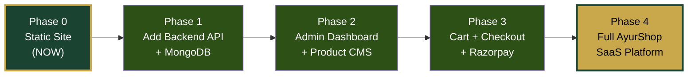

# 🌿 Galaxy Ayurveda — Quick Launch Website Master Plan
### Static-First Landing Site for Domain Presence | Phase 0 of AyurShop
#### Farhan Sayed | November 2026

---

## Executive Summary

**Goal:** Get a beautiful, professional, mobile-first website live on the **Galaxy Ayurveda** domain as fast as possible — showcasing the brand, listing products, and letting customers reach out via WhatsApp for orders.

**This is NOT the full AyurShop SaaS build.** This is **Phase 0** — a quick, polished static storefront that:
- Makes the domain useful immediately
- Builds brand credibility and online presence
- Lets customers browse products and place orders via WhatsApp
- Can be upgraded to the full AyurShop system later without rebuilding from scratch

> [!IMPORTANT]
> **Brand Identity:** Galaxy Ayurveda — A 100% herbal, Unani & Ayurvedic medicine shop. Authentic, traditional, and trusted.

---

## 🎯 What We're Building (Scope)

### ✅ In Scope (Phase 0 — Quick Launch)
| Feature | Details |
|---|---|
| **Homepage** | Hero banner, featured products, category highlights, about section, trust badges, WhatsApp CTA |
| **Products Page** | Grid listing of all products with images, names, prices, category filter |
| **Product Detail View** | Product image, name, price, description, "Order on WhatsApp" button |
| **About Page** | Brand story, shop info, herbal/Unani philosophy, trust signals |
| **Contact Page** | WhatsApp link, phone number, shop address, Google Maps embed |
| **Navigation** | Clean navbar with logo, category links, search (frontend filter), WhatsApp icon |
| **Footer** | Brand info, quick links, social media, licenses/trust badges |
| **WhatsApp Ordering** | "Order on WhatsApp" buttons that pre-fill message with product details |
| **Mobile Responsive** | Every page fully responsive, mobile-first design |
| **SEO Basics** | Meta tags, OG images, structured data for products |

### ❌ Out of Scope (Deferred to AyurShop Full Build)
| Feature | Why Deferred |
|---|---|
| Backend API / Database | Not needed for static site |
| Admin Dashboard | Products added via code/JSON for now |
| Shopping Cart & Checkout | Orders go through WhatsApp |
| Payment Gateway (Razorpay) | Not needed — WhatsApp + COD flow |
| Customer Accounts | No login needed |
| Order Management | Orders tracked via WhatsApp/manual |
| Analytics Dashboard | Use Vercel Analytics (free) for basic stats |
| Coupons & Promotions | Manual — mention in WhatsApp/banners |

---

## 🏗️ Tech Stack (Optimized for Speed & Simplicity)

| Layer | Choice | Why |
|---|---|---|
| **Framework** | Next.js 15 (App Router) | SSR/SSG, SEO-first, image optimization, same as full AyurShop build |
| **Language** | TypeScript | Type safety, reusable when we upgrade |
| **Styling** | Tailwind CSS v4 | Rapid UI, responsive, tiny bundle |
| **UI Components** | shadcn/ui | Beautiful, accessible, copy-paste components |
| **Icons** | Lucide React | Clean, consistent icon set |
| **Carousel** | Embla Carousel | Lightweight slider for hero & products |
| **Product Data** | Static JSON/TypeScript file | Easy to edit, no database needed |
| **Hosting** | Vercel (Free) | Zero-cost, auto-SSL, edge CDN, instant deploys |
| **Domain** | Galaxy Ayurveda domain | Connect to Vercel |
| **Images** | Next.js Image + `/public` folder | Optimized, lazy-loaded (Cloudinary later) |

> [!TIP]
> **Future-Proof:** We're using the exact same framework (Next.js + Tailwind + shadcn/ui) as the full AyurShop plan. When you're ready for the full build, these components and pages will **migrate directly** — zero throwaway work.

---

## 🎨 Design Direction (Inspired by Kama Ayurveda Reference)

### Visual Language
Based on the reference screenshots (Kama Ayurveda) and the Galaxy Ayurveda brand:

| Element | Direction |
|---|---|
| **Color Palette** | Deep Forest Green (`#1B4332`) as primary, Warm Gold (`#C9A84C`) as accent, Cream/Off-White (`#FDF8F0`) background, Dark Charcoal (`#2D2D2D`) text |
| **Typography** | Clean serif font for headings (Playfair Display), modern sans-serif for body (Inter/Poppins) — conveys tradition + professionalism |
| **Layout** | Clean, spacious, premium feel — generous whitespace like Kama Ayurveda |
| **Product Cards** | Large product images, clean white background, product name, short description, price, "Order on WhatsApp" CTA |
| **Hero Section** | Full-width image/slider with headline overlay — "100% Natural Herbal & Unani Medicines" |
| **Category Nav** | Horizontal category bar below navbar (like Kama Ayurveda reference) |
| **Trust Signals** | FSSAI badge, AYUSH badge, "100% Herbal" badge, "Est. Since XXXX" |
| **Mobile** | Hamburger menu, sticky WhatsApp button, simplified product grid (2 columns) |

### Color System

```
Primary:     #1B4332 (Deep Forest Green) — navbar, buttons, headings
Secondary:   #FDF8F0 (Warm Cream) — page backgrounds
Accent:      #C9A84C (Warm Gold) — highlights, badges, CTAs
Text:        #2D2D2D (Dark Charcoal) — body text
Light Green: #E8F5E9 (Mint Tint) — subtle backgrounds, cards
White:       #FFFFFF — card backgrounds, clean sections
```

---

## 📁 Project Structure

```
d:\HerbsConnect\
├── apps/
│   └── web/                          # Next.js 15 App
│       ├── public/
│       │   ├── images/
│       │   │   ├── products/         # Product images (manually added)
│       │   │   ├── banners/          # Hero banners
│       │   │   ├── categories/       # Category images
│       │   │   └── brand/            # Logo, favicon, trust badges
│       │   └── favicon.ico
│       ├── src/
│       │   ├── app/
│       │   │   ├── layout.tsx        # Root layout (Navbar + Footer)
│       │   │   ├── page.tsx          # Homepage
│       │   │   ├── products/
│       │   │   │   ├── page.tsx      # All Products listing
│       │   │   │   └── [slug]/
│       │   │   │       └── page.tsx  # Product detail page
│       │   │   ├── category/
│       │   │   │   └── [slug]/
│       │   │   │       └── page.tsx  # Products by category
│       │   │   ├── about/
│       │   │   │   └── page.tsx      # About Us
│       │   │   ├── contact/
│       │   │   │   └── page.tsx      # Contact page
│       │   │   └── not-found.tsx     # Custom 404
│       │   ├── components/
│       │   │   ├── layout/
│       │   │   │   ├── Navbar.tsx
│       │   │   │   ├── Footer.tsx
│       │   │   │   ├── MobileMenu.tsx
│       │   │   │   ├── AnnouncementBar.tsx
│       │   │   │   └── CategoryBar.tsx
│       │   │   ├── home/
│       │   │   │   ├── HeroSection.tsx
│       │   │   │   ├── FeaturedProducts.tsx
│       │   │   │   ├── CategoryShowcase.tsx
│       │   │   │   ├── WhyChooseUs.tsx
│       │   │   │   ├── TrustBadges.tsx
│       │   │   │   └── CTABanner.tsx
│       │   │   ├── products/
│       │   │   │   ├── ProductCard.tsx
│       │   │   │   ├── ProductGrid.tsx
│       │   │   │   ├── ProductDetail.tsx
│       │   │   │   ├── CategoryFilter.tsx
│       │   │   │   └── WhatsAppOrderButton.tsx
│       │   │   ├── shared/
│       │   │   │   ├── WhatsAppFloat.tsx      # Floating WhatsApp button
│       │   │   │   ├── BackToTop.tsx
│       │   │   │   ├── SearchBar.tsx
│       │   │   │   └── Breadcrumbs.tsx
│       │   │   └── ui/                # shadcn/ui components
│       │   │       ├── button.tsx
│       │   │       ├── card.tsx
│       │   │       ├── badge.tsx
│       │   │       ├── separator.tsx
│       │   │       ├── sheet.tsx       # Mobile menu drawer
│       │   │       └── ...
│       │   ├── data/
│       │   │   ├── products.ts        # 🔑 All product data (static)
│       │   │   ├── categories.ts      # Category definitions
│       │   │   └── siteConfig.ts      # Shop name, contact, social links
│       │   ├── lib/
│       │   │   ├── utils.ts           # cn(), formatPrice(), etc.
│       │   │   └── whatsapp.ts        # WhatsApp URL generator
│       │   └── styles/
│       │       └── globals.css        # Tailwind + custom styles
│       ├── next.config.ts
│       ├── tailwind.config.ts
│       ├── tsconfig.json
│       └── package.json
├── docs/                              # Existing documentation
└── images/                            # Reference images
```

> [!NOTE]
> **No monorepo overhead for Phase 0.** We use a simple Next.js app. The `apps/web/` folder structure is pre-aligned with the future AyurShop monorepo — when we add `apps/api/` and `packages/shared/`, this slots right in.

---

## 📦 Static Product Data Approach

Instead of a database, products are stored as a TypeScript file. This is **easy to update** and gives us full type safety.

### `src/data/products.ts`
```typescript
export interface Product {
  id: string;
  slug: string;
  name: string;
  shortDescription: string;
  description: string;           // Full HTML description
  price: number;                 // in ₹ (not paisa — simpler for static)
  mrp: number;
  category: string;              // category slug
  image: string;                 // path in /public/images/products/
  images?: string[];             // additional images
  tags: string[];
  isFeatured: boolean;
  isAvailable: boolean;
  weight?: string;               // "100g", "250ml"
}

export const products: Product[] = [
  {
    id: "1",
    slug: "ashwagandha-churna-100g",
    name: "Ashwagandha Churna",
    shortDescription: "Pure Ashwagandha root powder for strength & vitality",
    description: "<p>Premium quality Ashwagandha churna...</p>",
    price: 199,
    mrp: 299,
    category: "churna",
    image: "/images/products/ashwagandha-churna.jpg",
    tags: ["immunity", "strength", "herbal"],
    isFeatured: true,
    isAvailable: true,
    weight: "100g",
  },
  // ... more products added by you
];
```

### `src/data/categories.ts`
```typescript
export interface Category {
  slug: string;
  name: string;
  description: string;
  image: string;
  productCount: number;         // manually updated
}

export const categories: Category[] = [
  {
    slug: "churna",
    name: "Churna (Powders)",
    description: "Traditional Ayurvedic herbal powders",
    image: "/images/categories/churna.jpg",
    productCount: 0,
  },
  {
    slug: "oils",
    name: "Herbal Oils",
    description: "Pure cold-pressed therapeutic oils",
    image: "/images/categories/oils.jpg",
    productCount: 0,
  },
  {
    slug: "tablets",
    name: "Tablets & Vati",
    description: "Ayurvedic & Unani tablets and pills",
    image: "/images/categories/tablets.jpg",
    productCount: 0,
  },
  {
    slug: "syrups",
    name: "Syrups & Tonics",
    description: "Herbal syrups and health tonics",
    image: "/images/categories/syrups.jpg",
    productCount: 0,
  },
  {
    slug: "skincare",
    name: "Skincare",
    description: "Natural skincare and beauty products",
    image: "/images/categories/skincare.jpg",
    productCount: 0,
  },
  {
    slug: "haircare",
    name: "Haircare",
    description: "Herbal hair oils, shampoos and treatments",
    image: "/images/categories/haircare.jpg",
    productCount: 0,
  },
  {
    slug: "unani",
    name: "Unani Medicines",
    description: "Authentic Unani herbal formulations",
    image: "/images/categories/unani.jpg",
    productCount: 0,
  },
  {
    slug: "immunity",
    name: "Immunity & Wellness",
    description: "Boost your immunity naturally",
    image: "/images/categories/immunity.jpg",
    productCount: 0,
  },
];
```

### `src/data/siteConfig.ts`
```typescript
export const siteConfig = {
  name: "Galaxy Ayurveda",
  tagline: "100% Natural Herbal & Unani Medicines",
  description: "Galaxy Ayurveda — Your trusted source for authentic Ayurvedic, Unani, and 100% herbal medicines. Natural healing, time-tested traditions.",
  url: "https://galaxyayurveda.com",        // your domain
  
  contact: {
    phone: "+91-XXXXXXXXXX",                 // your phone
    whatsapp: "91XXXXXXXXXX",                // WhatsApp number (no +, no -)
    email: "contact@galaxyayurveda.com",
    address: "Your Shop Address",
    city: "Your City",
    state: "Your State",
    pincode: "XXXXXX",
    googleMapsEmbed: "",                     // embed URL
    businessHours: "Mon–Sat: 9:00 AM – 9:00 PM",
  },
  
  social: {
    instagram: "",
    facebook: "",
    youtube: "",
  },
  
  business: {
    fssaiLicense: "",
    ayushLicense: "",
    drugLicense: "",
    establishedYear: 2024,
  },

  announcement: {
    isActive: true,
    text: "🌿 Free Delivery on orders above ₹500! | 100% Natural & Herbal",
  },

  seo: {
    title: "Galaxy Ayurveda | 100% Natural Herbal & Unani Medicines",
    description: "Shop authentic Ayurvedic, Unani, and herbal medicines online. 100% natural, trusted quality. Order via WhatsApp for quick delivery.",
    ogImage: "/images/brand/og-image.jpg",
  },
};
```

> [!TIP]
> **Adding products is easy:** Just add a new object to the `products` array, drop the image in `/public/images/products/`, and deploy. No database needed.

---

## 🟢 WhatsApp Integration (Core Feature)

Since we're not building a cart/checkout, **WhatsApp is the primary order channel.**

### WhatsApp URL Generator — `src/lib/whatsapp.ts`
```typescript
import { siteConfig } from "@/data/siteConfig";

export function generateWhatsAppLink(product: {
  name: string;
  price: number;
  weight?: string;
}): string {
  const message = encodeURIComponent(
    `Hi! I'm interested in ordering from Galaxy Ayurveda:\n\n` +
    `📦 Product: ${product.name}\n` +
    `💰 Price: ₹${product.price}\n` +
    (product.weight ? `⚖️ Weight: ${product.weight}\n` : "") +
    `\nPlease share availability and delivery details. Thank you! 🌿`
  );
  return `https://wa.me/${siteConfig.contact.whatsapp}?text=${message}`;
}

export function generateWhatsAppEnquiryLink(): string {
  const message = encodeURIComponent(
    `Hi Galaxy Ayurveda! 🌿\n\n` +
    `I'd like to know more about your products. Can you help me?`
  );
  return `https://wa.me/${siteConfig.contact.whatsapp}?text=${message}`;
}
```

### Where WhatsApp Appears
| Location | Behavior |
|---|---|
| **Product Card** | "Order on WhatsApp" button → pre-fills product name + price |
| **Product Detail Page** | Large "Order on WhatsApp" CTA → pre-fills full product details |
| **Floating Button** | Fixed bottom-right WhatsApp icon → general enquiry |
| **Contact Page** | "Chat with us" button → general greeting |
| **Navbar** | WhatsApp icon in header (mobile & desktop) |

---

## 📄 Page-by-Page Specification

### 1. Homepage (`/`)

```
┌─────────────────────────────────────────────┐
│ 🟢 Announcement Bar                         │  "Free Delivery above ₹500!"
├─────────────────────────────────────────────┤
│ 🔍 Logo    [Galaxy Ayurveda]    📞 WhatsApp │  Clean navbar
├─────────────────────────────────────────────┤
│ Churna • Oils • Tablets • Skincare • ...     │  Category bar
├─────────────────────────────────────────────┤
│                                             │
│          🖼️ HERO BANNER / SLIDER            │  Full-width, headline overlay
│       "100% Natural Herbal & Unani          │
│            Medicines"                       │
│         [ Shop Now ]                        │
│                                             │
├─────────────────────────────────────────────┤
│                                             │
│        ⭐ FEATURED PRODUCTS (Grid)           │  4 cols desktop, 2 cols mobile
│   [Product] [Product] [Product] [Product]   │  Image, name, price, WhatsApp CTA
│                                             │
├─────────────────────────────────────────────┤
│                                             │
│        📂 SHOP BY CATEGORY                   │  Category cards with images
│   [Churna] [Oils] [Tablets] [Skincare]      │
│                                             │
├─────────────────────────────────────────────┤
│                                             │
│        🌿 WHY CHOOSE GALAXY AYURVEDA?        │  USP section
│   ✅ 100% Herbal  ✅ Unani Certified         │
│   ✅ Lab Tested   ✅ Free Delivery >₹500     │
│                                             │
├─────────────────────────────────────────────┤
│                                             │
│        🏪 ABOUT OUR SHOP                     │  Short about snippet + image
│   "Trusted for generations..."              │
│   [ Learn More → ]                          │
│                                             │
├─────────────────────────────────────────────┤
│                                             │
│        🛡️ TRUST BADGES                       │  FSSAI, AYUSH, Drug License
│   [Badge] [Badge] [Badge] [Badge]           │
│                                             │
├─────────────────────────────────────────────┤
│                                             │
│        📞 CTA BANNER                         │  "Have questions? Chat with us!"
│        [ WhatsApp Us Now 💬 ]               │
│                                             │
├─────────────────────────────────────────────┤
│ FOOTER                                      │  Brand info, links, contact, social
│ Galaxy Ayurveda | Est. XXXX                 │
│ Quick Links | Categories | Contact          │
│ © 2026 Galaxy Ayurveda                      │
└─────────────────────────────────────────────┘
```

### 2. Products Page (`/products`)
- **Header:** "Shop Authentic Herbal & Unani Products" (like Kama Ayurveda reference)
- **Sort:** Price Low→High, High→Low, Newest (frontend JS filtering)
- **Filter:** Category sidebar (desktop) / drawer (mobile)
- **Grid:** 3 columns desktop, 2 columns mobile
- **Product Card:** Image, category badge, name, short description, price (with MRP strikethrough if discounted), "Order on WhatsApp" button
- **Breadcrumbs:** Home > Products

### 3. Product Detail Page (`/products/[slug]`)
- Large product image (with zoom on hover)
- Product name, category badge
- Price display: ₹199 ~~₹299~~ (33% off)
- Weight/quantity info
- Full description (rich text)
- Tags (e.g., "Immunity", "Herbal", "Organic")
- **"Order on WhatsApp" CTA** (large, green button)
- **"Enquire on WhatsApp"** (secondary button)
- Related products section
- Breadcrumbs: Home > Products > [Product Name]

### 4. Category Page (`/category/[slug]`)
- Category header with name + description + image
- Product grid filtered by category
- Same product cards as Products page

### 5. About Page (`/about`)
- Brand story — Galaxy Ayurveda's philosophy
- "100% herbal, rooted in Unani & Ayurvedic traditions"
- Shop photo / owner photo
- Trust badges and licenses
- "Our Promise" section
- CTA: "Explore Our Products" + "WhatsApp Us"

### 6. Contact Page (`/contact`)
- Phone number (click to call)
- WhatsApp (click to chat)
- Email
- Full address
- Google Maps embed
- Business hours
- "Send us a message on WhatsApp" CTA

### 7. 404 Page
- Custom branded 404
- "Page not found" with search + link to homepage

---

## 🔧 Build Phases (Estimated Timeline)

### Phase 0.1 — Project Setup (Day 1, ~2 hours)
- [ ] Initialize Next.js 15 project with TypeScript
- [ ] Install and configure Tailwind CSS v4
- [ ] Set up shadcn/ui with green/gold theme
- [ ] Create `siteConfig.ts` with Galaxy Ayurveda details
- [ ] Create product and category data files with sample data
- [ ] Set up project folder structure
- [ ] Configure `next.config.ts` (images, metadata)

**Deliverable:** Project boots, `pnpm dev` shows a blank page.

---

### Phase 0.2 — Layout Shell (Day 1, ~3 hours)
- [ ] `AnnouncementBar` — dismissible top bar
- [ ] `Navbar` — logo (text for now), category links, search icon, WhatsApp icon
- [ ] `MobileMenu` — hamburger → slide-out drawer with categories + links
- [ ] `CategoryBar` — horizontal scrollable category links (like Kama Ayurveda)
- [ ] `Footer` — brand info, quick links, contact, social icons, trust badges, copyright
- [ ] `WhatsAppFloat` — fixed floating WhatsApp button (bottom-right)
- [ ] Root `layout.tsx` — compose all layout components
- [ ] Set up Google Fonts (Playfair Display + Inter)

**Deliverable:** Every page has navbar, footer, floating WhatsApp. Looks professional.

---

### Phase 0.3 — Homepage (Day 2, ~4 hours)
- [ ] `HeroSection` — full-width banner with overlay text, CTA button (static image initially, slider ready)
- [ ] `FeaturedProducts` — grid of `isFeatured: true` products, 4-col grid
- [ ] `CategoryShowcase` — category cards with images, linking to `/category/[slug]`
- [ ] `WhyChooseUs` — 4 USP cards (100% Herbal, Lab Tested, Free Delivery, Unani Certified)
- [ ] `TrustBadges` — license badges (FSSAI, AYUSH, Drug License, Est. Since)
- [ ] `CTABanner` — "Have Questions?" WhatsApp CTA section
- [ ] About snippet section with "Learn More" link

**Deliverable:** Fully styled homepage with all sections. Looks like a real Ayurveda brand.

---

### Phase 0.4 — Product Pages (Day 2-3, ~4 hours)
- [ ] `ProductCard` — image, name, short description, price, discount badge, WhatsApp CTA
- [ ] `ProductGrid` — responsive grid layout (3-col desktop, 2-col mobile)
- [ ] `CategoryFilter` — sidebar filter on desktop, drawer on mobile
- [ ] `SearchBar` — client-side search across product names/tags
- [ ] `Breadcrumbs` — navigation trail
- [ ] Products listing page (`/products`) with sort + filter
- [ ] Product detail page (`/products/[slug]`) with full layout
- [ ] Category page (`/category/[slug]`) filtered listing
- [ ] `WhatsAppOrderButton` — green CTA with pre-filled message
- [ ] Related products section on detail page

**Deliverable:** Customers can browse, search, filter, and click "Order on WhatsApp" on any product.

---

### Phase 0.5 — About & Contact Pages (Day 3, ~2 hours)
- [ ] About page with brand story, philosophy, trust signals
- [ ] Contact page with all contact methods + Google Maps
- [ ] Custom 404 page
- [ ] `BackToTop` scroll button

**Deliverable:** All pages complete.

---

### Phase 0.6 — Polish & SEO (Day 3-4, ~3 hours)
- [ ] Meta tags for all pages (title, description, OG image)
- [ ] Structured data (JSON-LD) for products and organization
- [ ] Favicon and site icons
- [ ] Loading states / skeleton screens
- [ ] Smooth scroll animations (fade-in on scroll)
- [ ] Image optimization (WebP, lazy loading, proper sizes)
- [ ] Accessibility check (alt text, keyboard navigation, contrast)
- [ ] Performance audit (Lighthouse > 90)
- [ ] Mobile testing across screen sizes

**Deliverable:** SEO-ready, performant, accessible site.

---

### Phase 0.7 — Deploy & Go Live (Day 4, ~1 hour)
- [ ] Push to GitHub repository
- [ ] Connect to Vercel
- [ ] Connect Galaxy Ayurveda domain to Vercel
- [ ] Set up SSL (automatic via Vercel)
- [ ] Verify all pages on production
- [ ] Submit sitemap to Google Search Console
- [ ] Test WhatsApp links on mobile

**Deliverable:** 🚀 **Galaxy Ayurveda is LIVE on the domain.**

---

## 📊 Total Estimated Effort

| Phase | Task | Time |
|---|---|---|
| 0.1 | Project Setup | 2 hours |
| 0.2 | Layout Shell | 3 hours |
| 0.3 | Homepage | 4 hours |
| 0.4 | Product Pages | 4 hours |
| 0.5 | About & Contact | 2 hours |
| 0.6 | Polish & SEO | 3 hours |
| 0.7 | Deploy | 1 hour |
| **Total** | | **~19 hours (3–4 days)** |

---

## 🔄 How This Connects to the Full AyurShop Build



### Migration Path
| Current (Phase 0) | Future (Full AyurShop) |
|---|---|
| Products in `products.ts` | Products in MongoDB via admin panel |
| Images in `/public/images/` | Images on Cloudinary CDN |
| WhatsApp ordering | Cart + Checkout + Razorpay |
| No admin panel | Full admin dashboard |
| Static categories | Database-driven categories |
| Vercel only | Vercel (frontend) + Render (API) |

> [!NOTE]
> **Zero throwaway code.** Every component we build now (ProductCard, Navbar, Footer, HeroSection, etc.) will be reused as-is or with minor modifications in the full AyurShop build. The data source changes from static file → API, but the UI stays the same.

---

## 🔮 Optional Quick Wins (If Time Permits)

These are small additions that make the site feel more complete:

| Feature | Effort | Value |
|---|---|---|
| **Product image zoom on hover** | 30 min | Premium feel |
| **Hero image slider** (Embla Carousel) | 1 hr | More dynamic homepage |
| **Animated counters** (Est. Since, Products, Happy Customers) | 30 min | Credibility |
| **"New" / "Bestseller" badges** on product cards | 20 min | Visual interest |
| **Dark mode toggle** | 1 hr | Modern touch |
| **Simple admin: JSON editor** at `/admin` (password-protected) | 2 hr | Easier product updates without code |

---

## 🛡️ Simple Admin Approach (Recommended for Phase 0)

> [!IMPORTANT]
> For Phase 0, we have **two options** for managing products. Choose one:

### Option A: Edit Code Directly (Simplest)
- You (developer) add/edit products in `src/data/products.ts`
- Push to GitHub → Vercel auto-deploys in ~30 seconds
- **Best for:** Getting live fastest, you control all changes

### Option B: Simple Admin Page (Slightly More Effort, +2 hours)
- Password-protected `/admin` page
- Shows a form to add/edit product JSON
- Saves to a local JSON file (or localStorage for demo)
- On production: you still update `products.ts` and deploy
- **Best for:** Planning ahead, getting a feel for the admin workflow

### Recommendation: **Start with Option A.** Get the site live. Add Option B when you have 10+ products and want easier management. Then transition to the full AyurShop admin dashboard when ready.

---

## ✅ Next Steps — Let's Start Building

1. **Confirm brand details** — Fill in `siteConfig.ts` values (phone, WhatsApp, address, license numbers)
2. **Gather product images** — Need product photos for initial listings
3. **Provide product data** — Names, prices, descriptions for 5-10 products to start
4. **Logo** — Do you have a Galaxy Ayurveda logo? Or should we create a text-based logo?
5. **Hero banner** — Any specific banner image or should we design one?

Once confirmed, I'll start building Phase 0.1 immediately. 🚀

---

*This plan was created as Phase 0 of the larger AyurShop project. All existing documentation (Blueprint, Technical Spec, Master Plan) remains valid for the full build and will be executed after this quick-launch site is live.*
